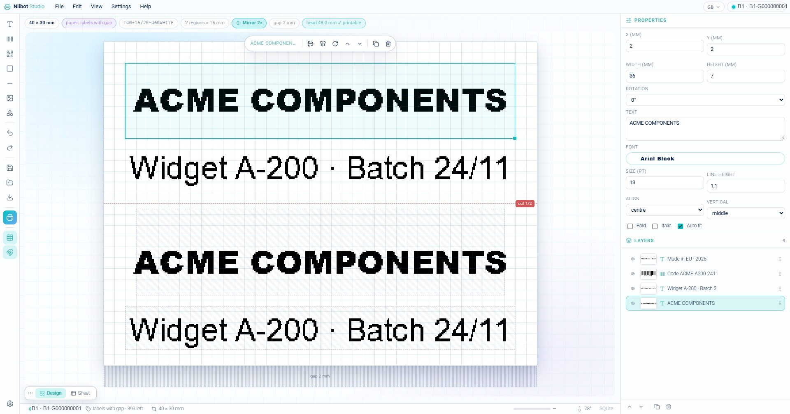
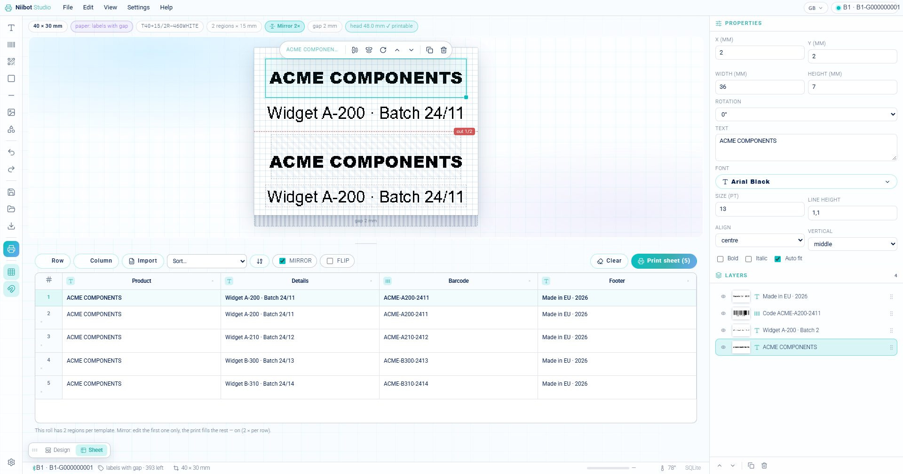
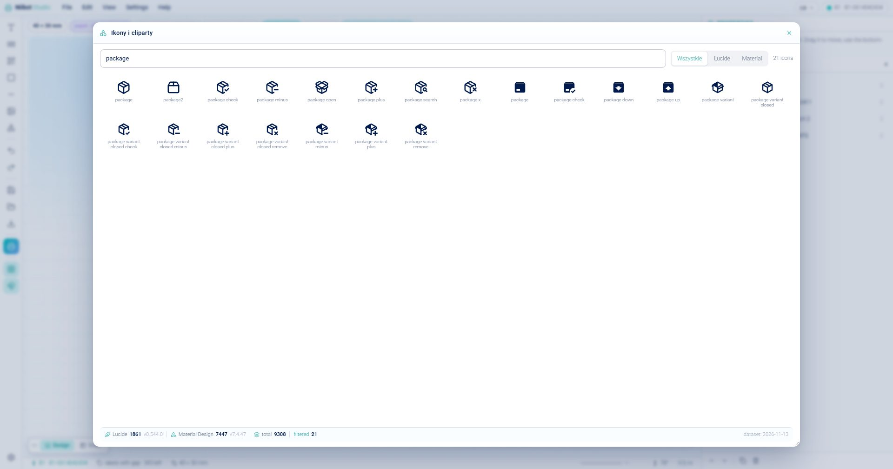
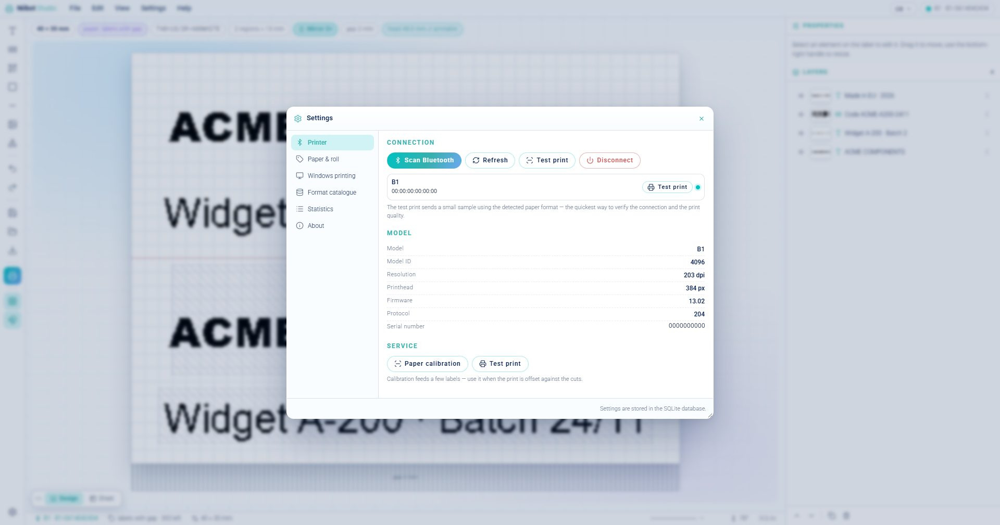
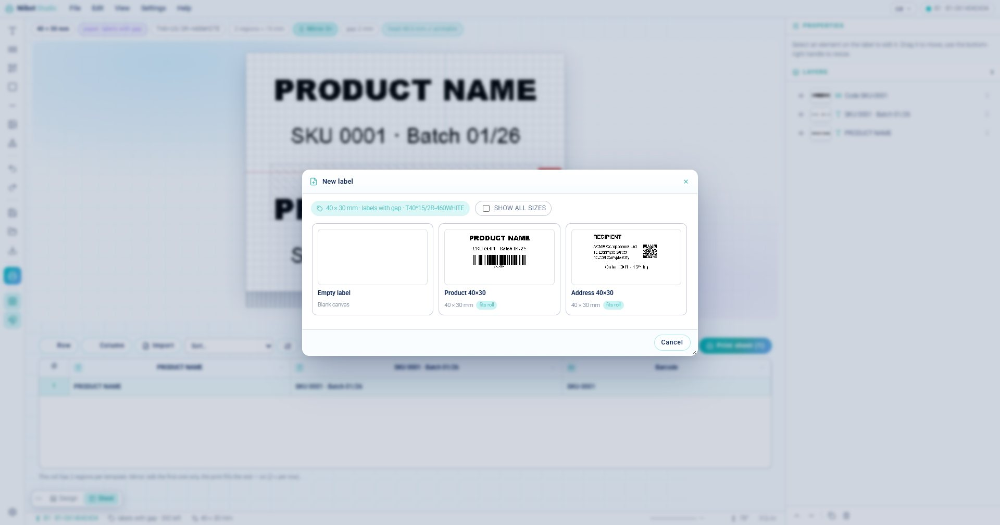

# Niibot Studio

Local label printing for **Niimbot B1** thermal printers over Bluetooth LE — no cloud, no
account, no vendor app. It is a small Python/FastAPI service with a full label designer in
the browser and an optional Windows print queue.

* **Pair and connect** to the printer over BLE (scan, remember the device, reconnect).
* **Paper detection**: lid state, paper presence, RFID tag of the roll (paper type, roll
  barcode, print counter, remaining labels).
* **Label designer**: text, barcodes (Code128/39/EAN/UPC/ITF), QR codes, frames, lines,
  images, rotation, alignment, auto-fit.
* **Fonts**: every installed system font is indexed (114 families on a stock Windows 11),
  with a live preview picker and a drop-in `data/fonts` folder for your own `.ttf`/`.otf`.
* **Icons and cliparts**: 9,308 searchable icons — 1,861 [Lucide](https://lucide.dev) (ISC)
  and 7,447 [Material Design Icons](https://pictogrammers.com/library/mdi/) (Apache-2.0) —
  inserted as print-ready PNGs.
* **Data sheet**: Excel-like grid where each column is bound to an element, with batch
  printing and *mirror* mode for multi-region rolls.
* **Photoshop-style layers**: visibility, thumbnails, rename, drag & drop ordering.
* **Grid, snapping and alignment guides** while dragging.
* **Windows printer**: registers itself as a normal print queue (IPP), scaling every job to
  the format read from the roll.
* **One SQLite file** holds settings, formats, labels, templates, images and print history.
* **CLI** for quick hardware checks.
* **Standalone Windows build** (`build-exe.ps1`) — no Python needed on the target machine.

Supported protocol families: B1/B21/D11 (`b1` task, 203 dpi, 384 px head) and newer 300 dpi
devices (`v4`, e.g. B1 Pro / B21 Pro).

---

## Screenshots

| Designer | Sheet |
| --- | --- |
|  |  |

| Icon browser | Settings |
| --- | --- |
|  |  |

**New label** — templates filtered to the roll read from the RFID tag:



---

## Quick start

```powershell
# from the project directory
.\\start.bat          # creates .venv, installs requirements, opens the panel
```

or manually:

```powershell
python -m venv .venv
.\\.venv\\Scripts\\pip install -r requirements.txt
.\\.venv\\Scripts\\python -m niibot panel
```

The panel opens at <http://127.0.0.1:8765>. Requirements: Windows 10/11 with Bluetooth LE,
Python 3.10+.

The interface is a local web app: the executable starts a small server on `127.0.0.1:8765` and
opens it in **its own window** (Edge/Chrome in app mode, with a private profile in `data\window`,
so it has no tabs or address bar and its own taskbar entry). `--no-browser` keeps the console only,
and on a machine without Edge/Chrome the default browser is used instead.

### Standalone executable

```powershell
powershell -ExecutionPolicy Bypass -File build-exe.ps1
```

The result is `dist\\NiibotStudio\\NiibotStudio.exe` — a self-contained folder (Python,
dependencies, web assets). `--port` and `--no-browser` work the same as with the module.
The version comes from `niibot/version.py`; see [CHANGELOG.md](CHANGELOG.md).

### Windows printer (one-time, as administrator)

```powershell
powershell -ExecutionPolicy Bypass -File install-printer.ps1
```

After that the printer shows up in **Settings → Bluetooth & devices → Printers** and any
application can print to it.

---

## Pairing

1. Turn the printer on (hold the power button).
2. In Windows: **Settings → Bluetooth & devices → Add device → Bluetooth**, pick the entry
   starting with `B1…` (PIN `0000` or `1234` if asked).
3. In the panel click **Scan** and pick the printer from the list.

The connection uses GATT directly (service `e7810a71-73ae-499d-8c15-faa9aef0c3f2`,
characteristic `bef8d6c9-9c21-4c9e-b632-bd58c1009f9f`), so no drivers or COM ports are needed.

**Scan lists every Bluetooth LE device**, not only Niimbot ones: a printer from another brand
(Fichero, Karsten, OEM clones) shows up as *BLE device* and can be selected, connected or
inspected. Press the stethoscope button next to a device to run **diagnostics** — it dumps the
GATT tree, reads the readable characteristics and records the notification traffic for a few
seconds, which is what identifies an unknown protocol (copy the report with one button). The same
is available from the terminal:

```powershell
python -m niibot scan --all              # every BLE device, labelled printer vs other
python -m niibot diagnose <address>      # services, values and notifications
```

A printer that never appears in the list is switched off, still paired to a phone, or speaks
**classic Bluetooth (SPP)** only — Windows exposes those as a serial port instead of a BLE
device, and they need a different transport than the one used here.

---

## Interface

| Area | What it does |
| --- | --- |
| menu bar | **File / Edit / View / Settings / Help** — save (also *Save as…*, *Save as template…*), undo, view toggles, settings |
| left toolbar | add elements, icon library, undo/redo, save, PNG export, print, **grid** and **snap** toggles |
| floating toolbar | actions on the selected element (centre, rotate, reorder, duplicate, delete) |
| right panel | **Properties** of the selection and the **Layers** list |
| bottom-left tabs | switch the work area between **Design** and **Sheet** |
| status bar | connection, paper status, format size, density, database |

Keyboard: `Ctrl+Z/Y` undo/redo, `Ctrl+S` save, `Ctrl+P` print, `Ctrl+D` duplicate,
`Delete` remove, arrows nudge by 1 mm (`Shift` = 0.2 mm), `G` grid, `S` snapping,
`Alt` while dragging = free movement, `Shift` while dragging = one axis.

### Canvas, grid and guides

Dragging is live: the element's own artwork lifts off the page and follows the pointer, the
rest of the preview dims. While dragging, edges and centres of other elements as well as the
label edges/centre produce subtle alignment guides (centre lines use a different colour).
With snapping on, positions snap to the 1 mm grid and to those guides.

**Hovering shows what a click would grab**: the element under the pointer gets a dashed frame and
a name chip, so it is clear what will move before pressing. An **unfilled frame** is caught on its
border only — everything it surrounds stays clickable. When several elements overlap, the chip
counts the stack (`1/3`) and **Ctrl+click** (Cmd on macOS) steps one element deeper, with the hover
frame following, so artwork hidden under a big block can still be picked.

### Sheet view

The **Sheet** tab treats the label as data:

* every value-bearing element (text, barcode, QR) becomes a **column**; the header holds an
  editable column name, the element type and a selector to re-bind the column,
* **row 1 is the current label** — editing it changes the design immediately,
* further rows are queued records; **Print sheet** prints row 1 and then every row in one job,
* **Mirror** (enabled when the roll has more than one region, e.g. `T40*15/2R`): you design
  only the first region and the remaining regions are filled at print time, either as a copy
  or as a vertical flip.

The sheet lives inside the label document, so it is saved, loaded and versioned with it.

### Layers

The list is reversed like in Photoshop — the top row is the topmost artwork. Each row has a
visibility eye, an ink-trimmed thumbnail of that element, the name (double-click to rename),
a drag handle and the ordering toolbar underneath.

### Fonts and icons

* **Properties → Font** (or **Edit → Font…**) opens a searchable list of all detected
  families rendered in their own typeface; the renderer loads the very same font file.
* **Left toolbar → icons** (or **Edit → Insert icon…**) opens the icon browser with source
  filter and tag search; picking an icon rasterises the SVG at the connected printhead width
  (384 px on a B1, 567 px on 300 dpi models) and uploads it into the database.
* Pictures and icons are placed with **`Contain`** fill, so resizing the box never cuts the artwork;
  `Cover` and `Stretch` stay available in **Properties → Fill mode**.

---

## Data: one SQLite file

Everything lives in **`data\\niibot.db`** (SQLite, WAL):

| Table | Contents |
| --- | --- |
| `settings` | key/value application state |
| `consumables` | label formats (built-in, imported from the vendor app, manual) |
| `labels` | saved label documents (JSON) |
| `templates` | user templates created with *Save as template…* |
| `profiles` | remembered geometry per physical roll |
| `uploads` | images and icons as BLOBs |
| `print_jobs` | print history → statistics |
| `ui_state` | everything the window remembers — see below |
| `schema_meta` | schema version |

Older JSON files (`labels.json`, `profiles.json`, `settings.json`) are migrated once on start.

**The browser stores nothing.** The working draft (the label you have not saved yet), the panel
widths, the sheet height, the grid/snap/region toggles, the print density, the chosen language and
the last calibration are all rows of `ui_state` (`GET`/`POST /api/ui`). That is why a reload, a
second window and the packaged EXE always open on the same picture, and why clearing the browser
cache cannot lose work. Anything an older build left in `localStorage` is moved into the database
and deleted on the first start.

---

## Paper detection and formats

The B1 firmware (13.02, protocol 204) answers `0x00` to `GetPaperInfo (0x59)`, so the printer
itself cannot report the format. The vendor app solves this with the RFID tag plus its cloud
API, and caches the answer in `localStorage`:

* `ConsumablesInfo-<serial>` — `allowNum`, `actualNum`, `materialUsed`, `statusCode`
* `ConsumablesTemplate-<barcode>` — width, height, paper type, rows, capacity

Niibot Studio reads that cache (`niibot/consumables.py`), stores the formats in SQLite and
matches the roll barcode read from the tag. SKU convention: `T<w>*<h>[/NR]-<count><colour>`,
where `2R` means two rows and the template height is `h × rows`. The roll used during
development is `T40*15/2R-460WHITE`: two 40 × 15 mm labels on a 40 × 30 mm template.

Without a known format, pick a preset in **Settings → Label** or enter the size manually;
the size is remembered per roll (`profiles`).

### Item zones (roll calibration)

The calibrator (`Correct calibration` on the label bar) is where a roll's printable area is
drawn. One **item zone** is one printable item on the label: it may be a single rectangle or
circle, or several outlines that belong to the same item (a circle plus a rectangular tab) —
the editor and the check print merge them into one area. Rows × columns lay out a grid of
zones in one go, and `Print zone borders` sends only those outlines to the printer so the
placement can be checked on the physical label.

The first chip in the label bar names the roll (or shows the label size when the roll has no name).

In the calibrator the **main size is one sticker**; the print page is derived from it and the grid
(2 across × 1 down = 42 × 21 mm) and the calibrator warns when it exceeds the printhead.
Dragging and resizing snap to 0.5 mm (hold Alt for 0.1 mm), and the grid matches that step; the
label centre and quarter lines are drawn behind the zones and catch a dragged edge or centre.

Zones are stored per roll (`regions` with their `shapes`) and drive the design stage overlay,
`Mirror cells` (design in the first zone, the rest is filled automatically) and sheet printing.

Every connection re-reads the calibration for the inserted roll code. A roll with no stored
calibration opens the **calibration library** — cards with a preview of the zones, the sticker size
and the print page, so an existing layout can be reused (`Use`), edited or replaced. Off-line the
last calibration stays on screen with an `⚠ offline calibration` badge, because the printer only
reports the roll code while it is connected.

---

## Keep-alive and automatic reconnect

A Bluetooth link dies quietly: Windows (and the printer itself) will drop an idle connection, and
the panel only polls while its window is visible. The server therefore pings every **5 s** on its own:

* Niimbot — a heartbeat frame (`0xDC`); the driver reports the link as dead when the frame fails.
* Fichero / LuckPrinter — the status query (`10 FF 40`); the reply also refreshes the
  lid/paper state sitting in the status bar.

A failed ping, or a link the printer closed itself, starts a **silent reconnect** with the address
and protocol used last: the printer is looked up by the scanner first (a peripheral that dropped
the link stops advertising for a moment), then connected again. Measured on a D11s: the link is
back in 14–28 s with no user action, and printing continues. An explicit **Disconnect** in the
panel stops the watchdog so it does not fight the user, and a recovery never hijacks a different
printer that was connected in the meantime.

`GET /api/state` reports it: `keep_alive.ping_age_s` (age of the last successful ping) and
`keep_alive.reconnects` (successful recoveries). `POST /api/keepalive/drop` closes the link on
purpose — a test hook.

### Connecting at start-up

The app reconnects to the printer you used last, without being asked. It scans for that printer
(by address, then by advertised name — a random BLE address changes when the printer is power
cycled), connects with up to three attempts and backs off from 8 s to 18 s while the printer is
away. A scan that sees the printer connects immediately. Windows' `find_device_by_address` is
deliberately **not** used: it returns a cached, nameless device for an address that is not
advertising, which made a switched-off printer look reachable — a nameless advertisement now gets
a single attempt and the address is skipped for 90 s. When the remembered printer does not answer,
the app connects to another printer it already knows that *is* advertising, and remembers it.

The status bar shows exactly what the reconnect is doing, and `GET /api/health` (the Ready / Not
Ready chip in the top-right corner) proves the backend itself is alive.

---

## Printer queue

The bottom of the right panel lists what was printed: state, size, time and printer, with the
running job on top and a progress bar. **Repeat** sends the exact same label or sheet again (the
spec is stored with the job, so the label does not have to be open), **Remove** drops the entry
from the history, and a running job offers **Cancel**. The handle above the list resizes the
section (double-click resets it) and the height is remembered.

`GET /api/queue` returns the history plus `current`; `POST /api/queue/{id}/repeat` prints it again
and `DELETE /api/queue/{id}` removes it. Jobs that did not come from the designer (the Windows IPP
queue) are kept for reference but cannot be repeated. The history is capped at 500 entries.

---

## Several printers, one library per printer

Switching printers is instant: a background manager keeps **every** printer the app knows
connected while it is advertising (and pings them so Windows does not drop the links), so the
right-click menu on the connection chip only lists what is already there — *printing now*,
*connected*, *in range* or *known, not in range* — and clicking a connected printer switches to it
with `POST /api/activate`, no scan involved. A printer that is off simply disappears from the
connected list and comes back when it is switched on again.

The app keeps **one workspace per printer type** (`niimbot:B1`, `luckprinter:FICHERO`, …):

| Belongs to | Where |
| --- | --- |
| working draft | `ui_state` key `draft:<scope>` |
| saved labels | `labels.device` |
| templates | `templates.device` |
| roll calibrations | `profiles.device` (key `<scope>|bc:<roll code>`) |
| printer registry | `printers` table (address, protocol, model, scope, last seen) |

Switching the printer switches all of it: a 40 × 30 mm B1 label is never offered to a 96 px D11s,
and both keep their own calibrations for the same roll code.

* **Detecting**: *Scan* looks at every BLE device, but the list only shows **printers** — a known
  address (one that was connected at least once) or a device whose name/service looks like a label
  printer (`B1…`, `D11…`, `FICHERO_…`, `D11s_…`, `Karsten…`, the Niimbot service or a
  LuckPrinter UART bridge). Tick **Show all Bluetooth devices** to see everything else in range
  (phones, trackers, sensors) — the switch is remembered in the database.
* **Switching**: the status bar shows `<model> · <protocol> · <device>`; **right-click it** to get
  the list of known printers and connect to one (or *Scan for printers…*).
* Data written before this feature is claimed by the first **Niimbot** printer that connects —
  the only family the earlier builds supported.

---

## Fichero / Karsten label printers (LuckPrinter family)

### How the gap calibration works on this family

The D11s has **no command that reports the label size** — `10 FF 70` returns the name, MACs,
firmware, serial and battery, nothing about the stock. What it does have is a **gap sensor** in the
paper path: once the paper type is set to *gap* (`10 FF 84 00`), every form feed makes the firmware
walk the paper until the sensor sees the gap and stop there, aligned to the next label. That is the
"calibration" the vendor app performs — it does not measure anything, it makes the printer seek.

The app therefore does the same, on request:

* **Settings → Paper → Calibrate gap** posts `/api/printer/gap-feed`, which sets the paper type to
  gap and sends two form feeds (`10 0C`, which answers `OK`, with `1D 0C` as the fallback), waiting
  for the acknowledgement after each. Each step reports whether paper was still present, so a roll
  whose gaps the sensor cannot see shows up immediately.
* The printer aligns itself, but it does not tell us the **label height**, and that height decides
  how many rows the raster has. **Settings → Paper → Measuring strip** loads a millimetre scale
  (`/api/calibration-strip`, `niibot/calibration.py`) into the designer: print it on the real roll,
  read the millimetres where the fold/gap falls, and enter that as the height (it is stored per roll
  with *Save size for this roll*).

Niimbot printers need none of this — they answer `GetLabelSize`, so **Detect format** just asks.

The cheap label printers sold as **Fichero** (Action) and the **Karsten** house brand are
AiYin D11s units built on the LuckPrinter SDK — a completely different protocol from
Niimbot's framed one. `niibot/luckprinter.py` holds the command bytes and
`niibot/fichero.py` the driver; both follow the reverse-engineered reference at
[0xMH/fichero-printer](https://github.com/0xMH/fichero-printer).

| | |
| --- | --- |
| Printhead | 96 px (≈ 12 mm at 203 dpi; 142 px on the wider variants) |
| Transport | one UART characteristic pair — `2af1`/`2af0`, `ff02`/`ff01`, `bef8d6c9` or `49535343` |
| Info | `10 FF 20 F0` model, `F1` firmware, `F2` serial, `10 FF 50 F1` battery, `10 FF 40` status |
| Settings | `10 FF 10 00 nn` density (0 light … 2 thick), `10 FF 84 nn` paper type, `10 FF 12 HH LL` auto-off |
| Print | wake (12 × `00`) → `10 FF FE 01` enable → `GS v 0` raster → `1D 0C` form feed → `10 FF FE 45` stop |

Pick **LuckPrinter (Fichero / AiYin)** in *Settings → Printer → Protocol* — or just press
*Connect* next to the device: the protocol is chosen from its name (`FICHERO_…`, `D11s_…`).
Everything else works as usual; this family has no roll tag, so its calibration is stored under
the fixed key `AIYIN` (make one with *Correct calibration*).

**Paper type and advance.** The panel numbers label types like Niimbot (1 = labels with gaps,
2 = black mark, 3 = continuous tape); this family uses 0/1/2. The mapping is done in
`luckprinter.paper_type_from_label_type()` and the paper type is sent before every print — sending
Niimbot's `1` unchanged made the printer look for a black mark, so it printed every label but never
moved to the next gap. The printer also does not walk to the tear bar on its own: *Settings →
Printer → Paper advance* holds the distance sent after each label (`1B 4A nn` dots), and
**Feed now** advances the paper once so the value can be dialled in; `POST /api/printer/feed`
does the same over HTTP.

---

## Device resolution (dpi) and unknown printers

Every label decision needs two numbers: the printer's **resolution** and its **printhead width in
pixels**. Both come from `niibot/models.py`, a 71-entry table of model ids (the id the printer
answers to `GetInfo 0x08`) with the values the vendor app uses — B1 = 203 dpi × 384 px,
B1 Pro = 300 dpi × 567 px, B2 Pro 300/567, B21 Pro 300/591, B3S 203/576, B4 Pro 300/1229,
M3 300/851, D11 203/96, … The label canvas, the renderer, the print packing and the Windows queue
all follow the connected device, so a 300 dpi printer gets 300 dpi artwork and PDFs are
rasterised at 300 dpi instead of being upscaled from 203.

A printer that is not in the table reports `unknown`, and the model panel says so. Use
**Settings → Printer → Printhead override** to enter the resolution (dpi), the printhead width in
pixels and, if needed, the print task (`Auto`, `B1 / legacy`, `V4`). The override is stored in
SQLite, applied to the live connection at once and survives restarts; clearing both numbers
returns to automatic detection.

Printers that speak a different protocol entirely (for example Finchero units, which have no
public Niimbot-compatible command set) still need a protocol implementation — the override only
fixes the geometry, not the command frames.

---

## Code size: why a QR or barcode cannot be shrunk forever

Both code types are grids of **modules** (a bar is one or more modules wide, a QR is a square of
them) and the printhead can only place whole dots, so the physical size is quantised:

```
module width = floor(box width in dots / module count)
```

`niibot/codes.py` counts the modules for the current payload and converts them to millimetres at the
connected dpi. Two numbers matter:

| | modules | 203 dpi (B1) | 300 dpi (B1 Pro) |
|---|---|---|---|
| floor — one dot per module | payload dependent | 0.125 mm | 0.083 mm |
| safe — two dots per module | payload dependent | 0.25 mm | 0.17 mm |

A 29-module QR needs 3.6 mm at 203 dpi to print at all and 9.3 mm to scan comfortably, while a
Code128 barcode of ten digits is 90 modules long — 11 mm bare, 27.5 mm with the quiet zone. The
editor therefore **stops the resize handle at the one-dot floor**, marks the element amber while it
is still under the safe size and shows both numbers (with the module count) in the inspector;
**Fit** grows the element to the safe size. The renderer refuses to print a code that cannot hold
one dot per module and reserves the quiet zone scanners need whenever the box has room for it.
`POST /api/code-size` returns the same numbers for any payload and format.

---

## Windows print queue (IPP)

Windows does not allow unsigned kernel drivers, so the app exposes an IPP endpoint
(`POST /ipp/print`) and `install-printer.ps1` registers a queue that uses the inbox
**Microsoft IPP Class Driver**. Jobs are decoded (PWG Raster / PDF / JPEG), fitted to the
detected format with `niibot/fit.py` (contain / cover / stretch, offsets, rotation, margin,
threshold, dithering, invert) and printed over BLE.

```powershell
# manual installation, elevated PowerShell
powershell -ExecutionPolicy Bypass -File install-printer.ps1
powershell -ExecutionPolicy Bypass -File uninstall-printer.ps1
```

---

## CLI

```powershell
python -m niibot scan                 # list nearby printers
python -m niibot info <address>       # model, firmware, paper, RFID
python -m niibot print --text "Hi"    # quick print
python -m niibot panel                # web UI
```

---

## How it works (protocol)

* Frame: `55 55 <cmd> <len> <data…> <crc> AA AA`, `crc` = XOR of cmd, len and data;
  the connect frame carries a `0x03` prefix.
* The B1 requires an exact handshake (`0xA5`, `0x40` for `08 0b 0d 0a 07 03 0c 09`, `0xDC[04]`),
  otherwise it accepts commands but never prints.
* Print job: `PrintStart`, `PageStart 0x03`, `SetPageSize 0x13`, rows as `0x84`/`0x85`
  packets, then poll `0xA3` until the page counter reaches the copy count and send `0xF3`.
* The B1 drops rows at full speed — the transport paces writes (10 ms) and bundles frames.

---

## Project layout

```
niibot/            protocol, BLE transport, printer client, renderer, IPP, storage, server
web/               designer UI (index.html, style.css, app.js) + vendored icon libraries
tests/             protocol + storage/IPP tests (python -m unittest discover -s tests)
data/              SQLite database, uploads, font index, custom fonts (git-ignored)
install-printer.ps1 / uninstall-printer.ps1
build-exe.ps1      PyInstaller bundle
CHANGELOG.md
```

---

## Troubleshooting

| Symptom | Fix |
| --- | --- |
| Printer not found | check Windows pairing, then **Scan**; other BLE apps may hold the connection |
| Connects but nothing prints | run **Test print** in Settings → Printer; inspect `/api/log` for frame errors |
| Print shifted against the cuts | run **Paper calibration** in Settings → Printer |
| Everything is cut off on the right | the label is wider than the printhead — the stage shows the limit |
| Port already in use | `python -m niibot panel --port 8766` |

---

## Credits

* Protocol knowledge from the reverse-engineered Niimbot community projects
  (`niimbot-web-bluetooth`, `niimbluelib`, `niimprint`).
* Icons: [Lucide](https://lucide.dev) (ISC) and
  [Material Design Icons](https://pictogrammers.com/library/mdi/) (Apache-2.0).
* UI inspiration: VS Code shell, SunCore/BUI colour language.

## License

**MIT** — free for personal and commercial use, modification and redistribution; see
[LICENSE](LICENSE). Bundled third-party components keep their own permissive licences
(ISC, Apache-2.0, BSD, MIT) and are listed with attribution in
[THIRD-PARTY-NOTICES.md](THIRD-PARTY-NOTICES.md). Fonts are not redistributed — the app uses
the fonts installed on your machine or the ones you drop into `data/fonts`.
